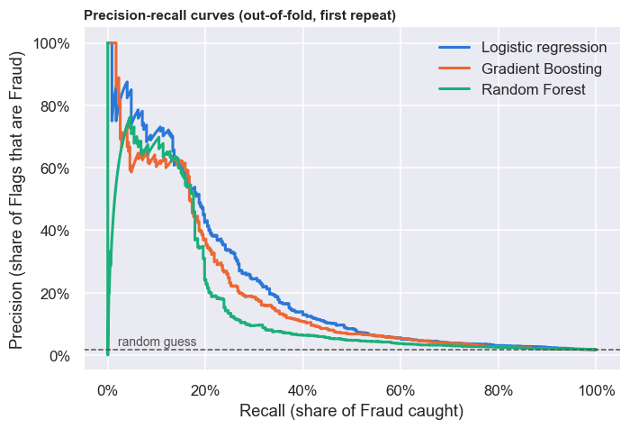
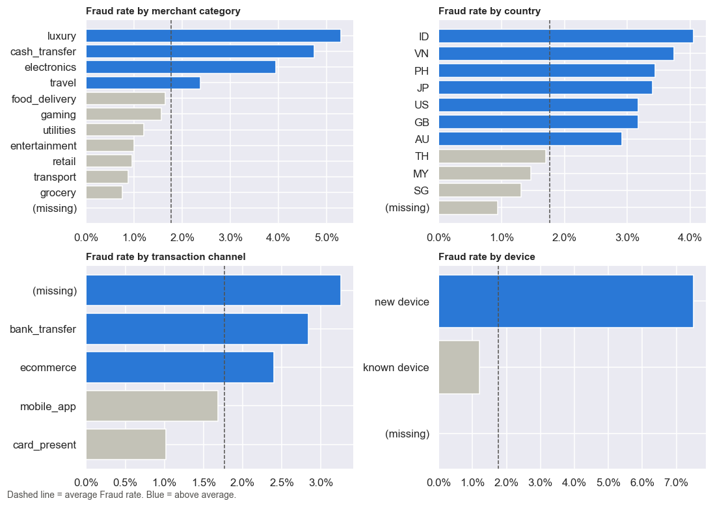
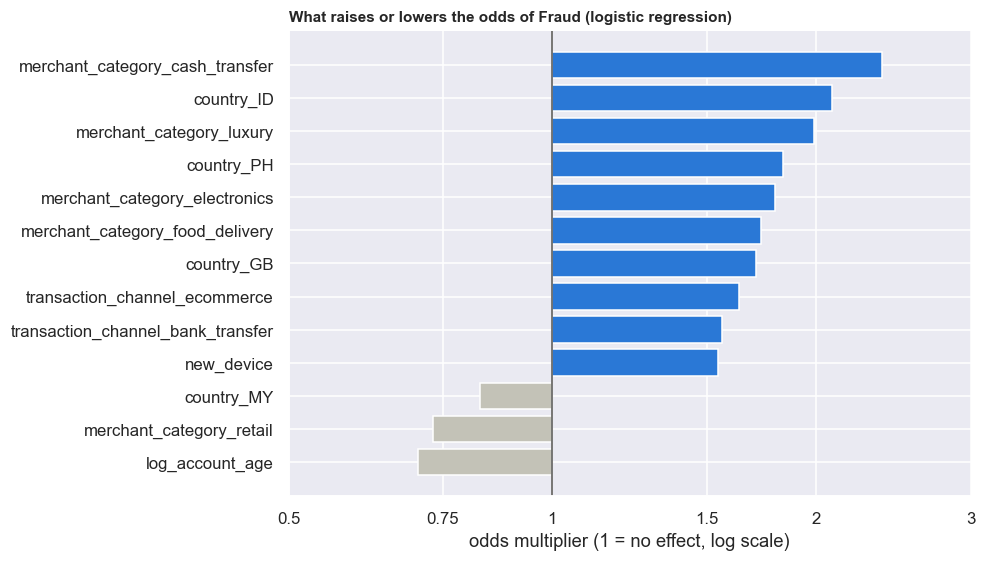
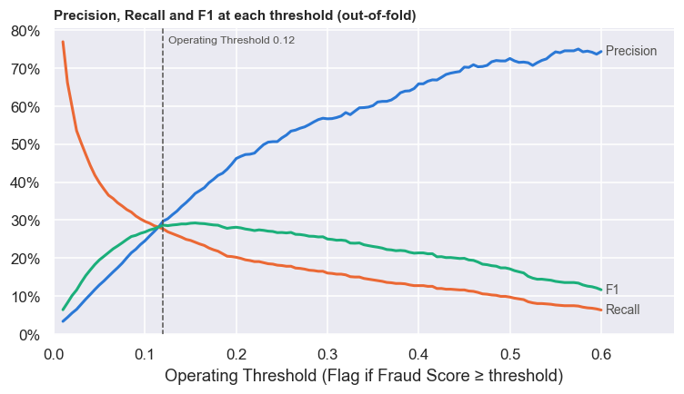
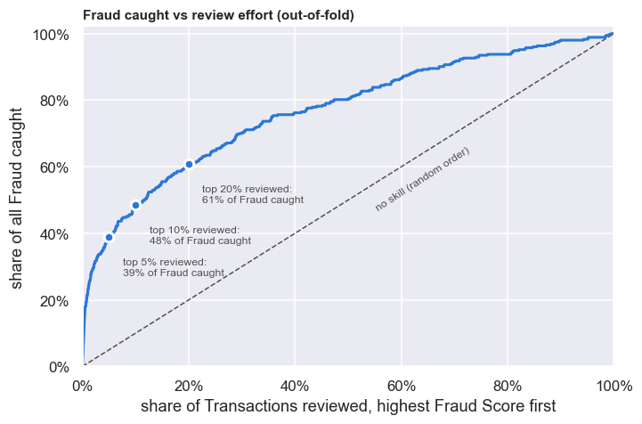

# Intelligent Financial Fraud Detection

**NTU Datathon 2026 · Track 2** — Sakthivel and Swarup

How can machine learning catch fraudulent transactions while disrupting as few legitimate customers as possible? Only **1.8%** of the 20,000 training transactions are fraud. A model that flags nothing would be 98.2% accurate and completely useless, so this project is judged on **PR-AUC, F1 and Recall**.

The final model is a **regularised logistic regression with engineered features**. It beat Random Forest, Gradient Boosting, SMOTE and class weighting in repeated cross-validation, and every one of its predictions can be explained as odds multipliers.

<p align="center"></p>

## Results

All scores come from **5-fold stratified cross-validation repeated 3 times** (15 folds, mean ± sd).

| Model | PR-AUC | Notes |
|---|---|---|
| Random guess | 0.018 | the fraud rate |
| Rule: flag every new device | 0.040 | the strongest single signal |
| Random Forest | 0.178 | most precise flags, but catches the least fraud |
| Gradient Boosting + SMOTE | 0.198 | synthetic frauds did not help |
| Gradient Boosting | 0.203 | |
| Logistic regression (baseline) | 0.228 | beats every candidate in ≥ 13 of 15 folds |
| **Final: tuned logistic regression** | **0.236** | `C=0.1` + 5 extra features; better than the baseline in 12 of 15 folds |

At a deliberately chosen **Operating Threshold** (0.12 instead of the default 0.5), logistic regression flags about 1.6% of transactions. About 3 in 10 of those flags are real fraud, with only 1.2% false alarms (F1 0.287, Recall 0.277). At 0.5 it would catch under 10% of fraud. With the final model, reviewing only the **top 5%** of scores catches **39% of all fraud**.

## What's inside

- **Exploratory analysis.** Fraud concentrates on new devices (6× the base rate), on cash transfers, luxury and electronics merchants, late at night, on large amounts, on young accounts and in bursts of activity. It also covers data-quality checks on the activity counters.
- **Leak-free preprocessing.** Imputation, scaling and one-hot encoding are learned inside each training fold through scikit-learn pipelines.
- **Feature engineering.** Log transforms, amount relative to the account's recent spend, cyclical hour encoding, a night flag and interaction terms. Their value is shown with and without them.
- **Model comparison.** All models are compared on identical folds, with fold-by-fold win counts instead of mean differences that sit inside the noise.
- **Threshold selection.** The threshold that maximises F1 is found, then moved down while F1 stays within 0.01 of the best, to catch more fraud. A nested check shows that tuning the threshold on the same data barely inflates the scores.
- **Trust checks.** Learning curves show no over- or underfitting, and the scores are well calibrated. A **bias audit** by country and channel finds that fraud in Singapore and in card-present transactions is caught far less often. It traces the cause to the data, not the `country` feature.
- **Robust scoring.** `make_features` guards against text in numeric columns, infinities and values outside the training range. Predictions do not depend on row order or on the `id` column.

## Figures

| | |
|---|---|
|  |  |
|  |  |

## Repository layout

```
├── data/                      train.csv, test.csv (from the organisers)
├── notebooks/
│   ├── fraud_detection.ipynb  full analysis: EDA → features → models → threshold → trust checks
│   └── predict.ipynb          self-contained scoring notebook (as submitted)
├── src/fraud_detection/
│   ├── features.py            make_features: cleaning guards + engineered features
│   └── predict.py             command-line scoring
├── models/model.pkl           final pipeline + threshold, saved as (model, feature_names)
├── outputs/test_predictions.csv  id, fraud_score, flag for the public test set
├── reports/figures/           charts used in this README
└── tests/                     feature guards and notebook/package consistency
```

## Run it

```bash
python -m venv .venv && source .venv/bin/activate
pip install -r requirements.txt

# Reproduce the analysis, model.pkl and the test predictions
jupyter nbconvert --to notebook --execute --inplace notebooks/fraud_detection.ipynb

# Score any CSV with the raw transaction columns
PYTHONPATH=src python -m fraud_detection.predict data/test.csv outputs/test_predictions.csv

pytest
```

Built with Python 3.12, pandas, scikit-learn (1.5, for `FixedThresholdClassifier`), imbalanced-learn and matplotlib.

## Limitations

- Recall of about 28% leaves most fraud uncaught. That is the cost of keeping false alarms near 1%. With real costs for a missed fraud and for a false alarm, the threshold should be set from those costs rather than from F1.
- The public test set is shifted towards larger amounts and new devices, so the flag rate there is higher than in training.
- The dataset has no account identifier, so transactions are treated as independent. Account history would likely add more than a more complex model would: the learning curve flattens at about half the data.

## License

The code is released under the MIT license. The dataset belongs to the NTU Datathon 2026 organisers.
